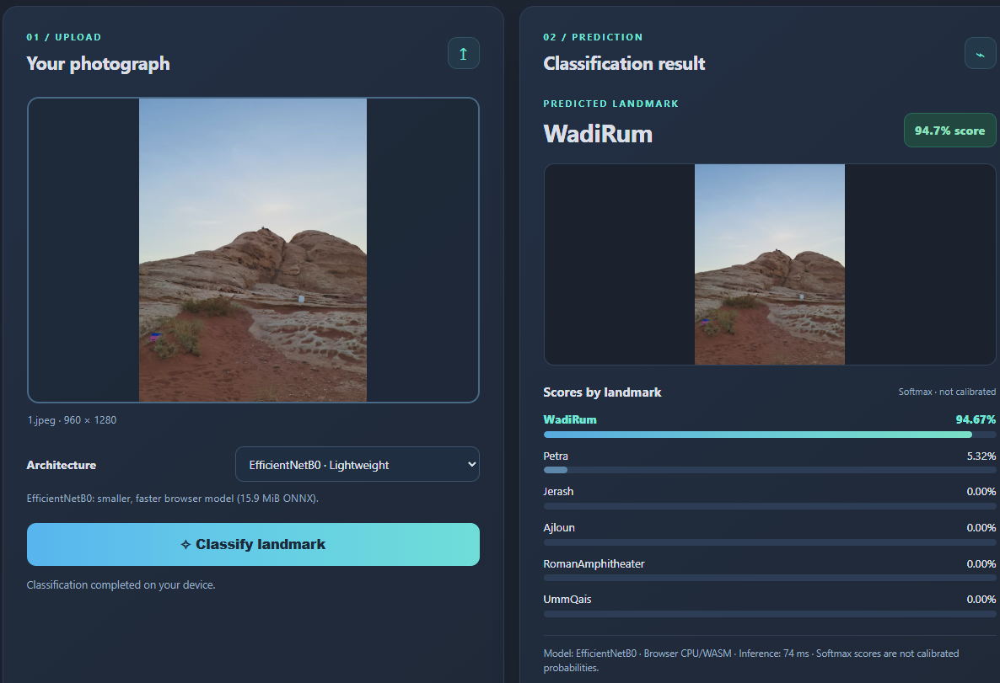
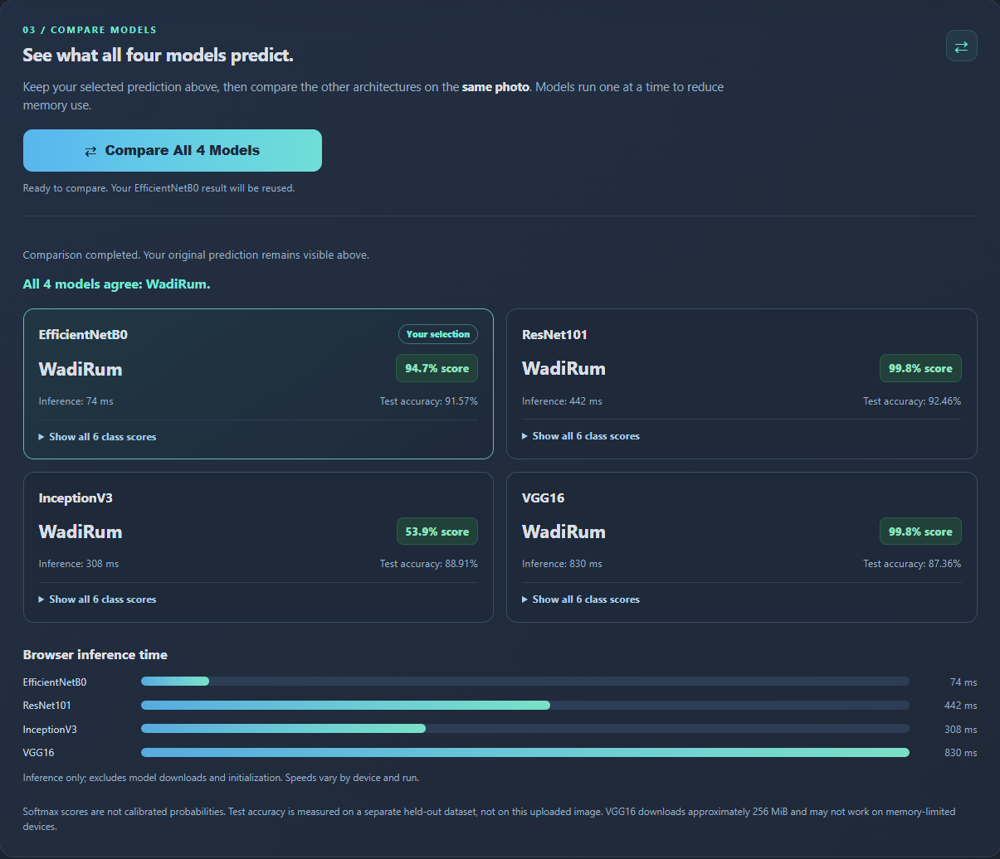
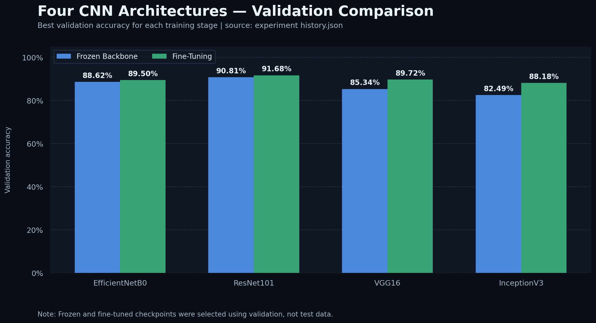
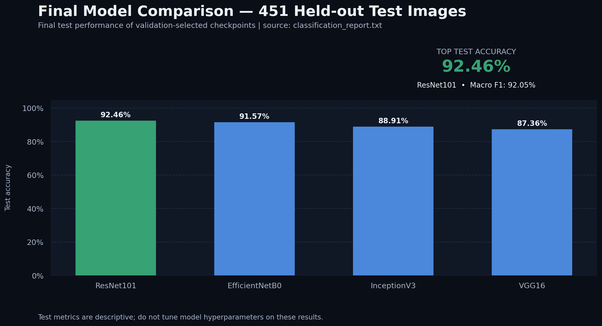

<div align="center">

# 🇯🇴 JordanHeritageVision

### From raw landmark photographs to explainable, in-browser AI.

**An end-to-end computer vision project for recognizing Jordanian landmarks —**
**with rigorous dataset curation, eight transfer-learning experiments, four deployed CNNs, and interactive model comparison.**

[](https://maen-qawasmeh.github.io/JordanHeritageVision/)
[](https://github.com/Maen-Qawasmeh/JordanHeritageVision)


**4 CNN architectures** · **8 experiments** · **6 landmark classes** · **451 held-out test images**

</div>

---

## At a glance

| Best held-out test accuracy | Highest validation accuracy | Models available in-browser | Original dataset | Cleaned evaluation protocol |
|:---:|:---:|:---:|:---:|:---:|
| **92.46%** | **91.69%** | **4** | **3,688** images | **2,236 / 457 / 451** train / val / test |

**The central question:** *Can a model recognize places that look surprisingly similar — ancient columns, stone facades, Roman theaters, and desert landscapes — and can we explain both its successes and its mistakes?*

This project goes beyond a single accuracy score. It follows the ML lifecycle from **data inspection and duplicate-aware cleaning**, through **transfer learning and controlled comparisons**, to **test-set evaluation, error analysis, Grad-CAM explainability, model-size benchmarking**, and a **public, serverless browser demo**.

> **[Open the live application](https://maen-qawasmeh.github.io/JordanHeritageVision/)** · No account or API key required. Model inference runs in your browser; uploaded photos are not sent to a prediction backend.

## Live application — see the models think

The site has two connected experiences:

- **01 — Single-model prediction:** Upload a photo, choose an architecture, and inspect its top label, six class scores, and inference time.
- **02 — Compare all four models:** With the same uploaded image, run the other architectures sequentially and explore disagreements, score distributions, and a browser-speed comparison. The original prediction remains visible above.

<div align="center">



<sub>Actual browser run — single-model prediction with EfficientNetB0.</sub>

<br/><br/>



<sub>Actual comparison run — all four architectures predicted WadiRum for the same example image.</sub>

</div>

**How to try it:** Open the [demo](https://maen-qawasmeh.github.io/JordanHeritageVision/) → upload a Jordanian landmark photo → choose a model → click **Classify landmark** → scroll down and select **Compare All 4 Models**.

> The displayed percentages are **Softmax scores, not calibrated probabilities**. The timings measure *model inference only* on the visitor's device and exclude model downloads/initialization. First-run downloads — especially VGG16 — may take time.

---

## The six places the models recognize

| Class label | Landmark / region |
|---|---|
| `Ajloun` | Ajloun |
| `Jerash` | Jerash |
| `Petra` | Petra |
| `RomanAmphitheater` | Roman Amphitheater, Amman |
| `UmmQais` | Umm Qais |
| `WadiRum` | Wadi Rum |

This is a **six-class image classifier**, not a geolocation system. It predicts among the classes seen during training; an unrelated photo can still receive a high score.

## The pipeline

```text
3,688 original images · 6 classes
              │
              ▼
   Dataset inspection and quality review
   ├── Exact duplicate checks (SHA-256)
   ├── Conflicting-label duplicate groups
   └── Conservative near-duplicate review
              │
              ▼
3,144 images in final curated manifests
   ├── Train       2,236
   ├── Validation    457
   └── Test          451  ← held out until final evaluation
              │
              ▼
Transfer learning with pretrained CNNs
   4 architectures × 2 training strategies
              │
              ▼
8 experiments → checkpoint selection on validation
              │
              ▼
Held-out test evaluation + error analysis
              │
              ▼
Grad-CAM explanations + efficiency benchmarks
              │
              ▼
PyTorch → ONNX → ONNX Runtime Web
              │
              ▼
GitHub Pages · Single-model & four-model demo
```

### Dataset integrity comes first

The original collection contained **3,688 images**. The final experiment manifests contain **3,144 images**. Cleanup covered exact duplicate image content, duplicate groups with inconsistent class labels, and conservatively reviewed near-duplicate candidates. The original raw files were left unchanged; exclusions were implemented through the split manifests.

| Split | Images | Purpose |
|---|---:|---|
| Train | **2,236** | Fit model parameters |
| Validation | **457** | Track training and select checkpoints |
| Test | **451** | Final held-out measurement |
| **Total** | **3,144** | Final curated experiment set |

The source images, local split manifests and trained PyTorch checkpoints are **not** committed to the public repository. Scripts are included to inspect and prepare data, but full reruns require access to the source dataset under appropriate permissions. The cleaning process does not guarantee that every visually similar or mislabeled image has been resolved.

---

## Eight experiments. Four architectures. One held-out test set.

Each model was trained in two phases:

1. **Frozen backbone:** Keep the pretrained feature extractor frozen and fit a new classification head.
2. **Fine-tuning:** Unfreeze selected later layers and continue at a lower learning rate.

| Architecture | Frozen validation acc. | Fine-tuned validation acc. | Gain |
|---|---:|---:|---:|
| EfficientNetB0 | 88.621% | 89.497% | +0.876 pp |
| **ResNet101** | 90.810% | **91.685%** | +0.875 pp |
| VGG16 | 85.339% | 89.716% | +4.377 pp |
| InceptionV3 | 82.495% | 88.184% | **+5.689 pp** |

<div align="center">

</div>

### The results that matter: final test set

**All four best checkpoints were evaluated on the same 451-image held-out test set.**

| Model | Test accuracy | Macro F1 | Correct / 451 | Incorrect / 451 |
|---|---:|---:|---:|---:|
| **ResNet101 🏆** | **92.46%** | **92.05%** | **417** | 34 |
| EfficientNetB0 | 91.57% | 91.16% | 413 | 38 |
| InceptionV3 | 88.91% | 88.39% | 401 | 50 |
| VGG16 | 87.36% | 86.92% | 394 | 57 |

<div align="center">

</div>

**What the comparison reveals:**

- **ResNet101** achieved the highest held-out test accuracy and macro F1.
- **EfficientNetB0** was only **0.89 percentage points** behind ResNet101 on test accuracy while using a substantially smaller deployment artifact.
- **InceptionV3** delivered the largest validation gain from fine-tuning, but did not top the test ranking.
- **VGG16** improved strongly with fine-tuning, yet finished last on the held-out test set and is the most demanding model to serve in-browser.
- **Validation ranking ≠ test ranking.** Report both, rather than selecting a flattering single metric.

> These are **dataset-specific measurements**, not evidence of universal landmark recognition performance. See [`assets/results_summary.csv`](assets/results_summary.csv) for the exported comparison table.

---

## Interpreting model behavior, not only scores

### Error analysis

A dedicated pipeline ([`analyze_errors.py`](analyze_errors.py)) exports per-image predictions, misclassified samples, class-confusion pairs, and a visual gallery of selected errors. This helps inspect cases where similar architectural features or desert scenes cause confusion.

The review also surfaced **potentially inconsistent dataset labels** in some high-confidence errors. These were treated as *audit findings*, not silently relabeled to improve reported test accuracy. Final test labels and checkpoints were not changed post-evaluation.

### Grad-CAM explainability

[`generate_gradcam.py`](generate_gradcam.py) creates Grad-CAM visualizations for a model's **predicted class and recorded class** using the exact deterministic evaluation crop. The goal is to ask *which image regions contributed to each prediction?* — not to pretend a heatmap proves the model's reasoning is correct.

Example local analysis workflow (requires checkpoints and images):

```powershell
python analyze_errors.py --checkpoint outputs/experiment_04_resnet101/checkpoints/best_model.pt --split-dir data/splits_final --output-dir outputs/error_analysis/resnet101 --batch-size 8

python generate_gradcam.py --checkpoint outputs/experiment_04_resnet101/checkpoints/best_model.pt --split-dir data/splits_final --errors-csv outputs/error_analysis/resnet101/misclassifications.csv --output-dir outputs/gradcam/resnet101 --top-n 12
```

Generated error galleries and image-level Grad-CAM panels remain local unless their source-image redistribution rights have been checked.

---

## Model engineering: accuracy vs. the cost of inference

Accuracy alone did not choose the deployment architecture. The demo provides all four models and exposes practical trade-offs:

| Deployed model | Test accuracy | Browser ONNX payload (approx.) | Input crop | Practical role |
|---|---:|---:|---:|---|
| EfficientNetB0 | 91.57% | **15.9 MiB** | 224 × 224 | Lightweight default |
| ResNet101 | **92.46%** | 81.5 MiB | 224 × 224 | Accuracy leader |
| InceptionV3 | 88.91% | 42.0 MiB | **299 × 299** | Architecture comparison |
| VGG16 | 87.36% | **256.15 MiB**, 7 parts | 224 × 224 | Heavyweight baseline |

To keep the demo static and free to host:

- Convert trained PyTorch checkpoints into **ONNX** and load them with **ONNX Runtime Web (WASM)**.
- Fetch **only the model needed**, release the previous session before switching, and run the comparison **sequentially**.
- Preserve per-model inference metadata: class order, resize/crop rules, ImageNet normalization and input/output tensor names.
- Store VGG16's large ONNX artifact as **seven ordered chunks** and reassemble it in-browser, with size/integrity checks.
- Keep image processing **on the user's device** rather than posting photos to an inference API.

**Separate benchmark:** [`benchmark_models.py`](benchmark_models.py) measures model-only throughput with synthetic batches on a local GPU. In an RTX 3050 Laptop GPU test (batch size 8, mixed precision), the recorded median batch times were **9.54 ms** for EfficientNetB0 and **29.58 ms** for ResNet101. These GPU batch measurements are **not comparable** with the browser's CPU/WASM per-image inference times.

> **Device note:** VGG16 is a large download and may exceed the memory available on phones or constrained browsers. Browser inference time and download performance depend on the device, browser, network and caching behavior.

---

## Repository map

```text
JordanHeritageVision/
├── docs/                       # Static GitHub Pages application
│   ├── index.html
│   ├── app.js
│   ├── styles.css
│   └── model/                  # Deployment ONNX weights + metadata
├── assets/                     # Figures, metrics, and demo screenshots
├── heritagevision/             # Training, dataset, checkpoint, architectures
│   ├── architectures/
│   ├── models.py
│   ├── data.py
│   ├── training.py
│   └── checkpoints.py
├── train_*.py                  # Four model-specific training entry points
├── evaluate.py                # Held-out test evaluation
├── analyze_errors.py          # Error audit + galleries
├── generate_gradcam.py        # Explanations of classification behavior
├── benchmark_models.py       # GPU speed / memory comparisons
├── prepare_data*.py           # Dataset preparation and cleaning tools
├── finalize_clean_splits.py  # Final reviewed manifests
├── export_*_onnx.py           # Browser-format export scripts
├── generate_readme_charts.py  # Rebuild charts from local reports
├── requirements.txt
├── README.md
├── data/                       # Local only; excluded from Git
└── outputs/                    # Local checkpoints / reports; Git-ignored
```

### Run the browser demo locally

```powershell
git clone https://github.com/Maen-Qawasmeh/JordanHeritageVision.git
cd JordanHeritageVision
python -m http.server 8000 --directory docs
```

Open **http://localhost:8000**. The browser needs internet access for the pinned ONNX Runtime Web assets. Running through a local HTTP server is important; do not open `docs/index.html` using `file://`.

### Work with the PyTorch source

```powershell
python -m pip install -r requirements.txt
python train_ResNet101.py --help
python evaluate.py --help
```

**Training or reevaluation requires the source images, cleaned split manifests, and (for checkpoint-based evaluation) the saved PyTorch checkpoint**, which are not included in the GitHub clone.

Example model training sequence used in the experiments (once local data manifests exist):

```powershell
# Frozen backbone
python train_ResNet101.py --split-dir data/splits_final --epochs 6 --finetune-epochs 0 --batch-size 8 --output-dir outputs/experiment_03_resnet101

# Fine-tuning from the frozen checkpoint
python train_ResNet101.py --split-dir data/splits_final --epochs 0 --finetune-epochs 12 --finetune-from outputs/experiment_03_resnet101/checkpoints/best_model.pt --batch-size 8 --output-dir outputs/experiment_04_resnet101

# Evaluate the best validation-selected checkpoint
python evaluate.py --checkpoint outputs/experiment_04_resnet101/checkpoints/best_model.pt --split-dir data/splits_final --output-dir outputs/final_evaluation/resnet101 --batch-size 8
```

To regenerate the chart images from locally saved training histories and evaluation reports:

```powershell
python generate_readme_charts.py
```

No synthetic experiment scores are inserted into the figure generator; missing reports cause it to stop rather than invent data.

---

## Limitations and next directions

- **Closed-set problem:** One of six labels is always predicted, even for out-of-distribution photos; a reject/unknown class is not implemented.
- **Data quality:** Potential annotation errors and close visual overlaps still merit independent review. No post-hoc edits were made to the held-out test set to improve numbers.
- **Score calibration:** Softmax output is not a trustworthy real-world probability without calibration.
- **Deployment constraints:** Downloading VGG16 (~256 MiB) is unsuitable for many mobile devices. Sequential execution reduces peak concurrent session use but does not eliminate memory pressure.
- **Future experiments:** Confidence calibration, out-of-distribution detection, robustness testing with new photographs, ONNX graph optimization/quantization, and repeatable browser smoke tests.

## Attribution and author

Created and developed by **Maen Qawasmeh** as a Computer Vision / Deep Learning portfolio project.

- **Project repository:** [Maen-Qawasmeh/JordanHeritageVision](https://github.com/Maen-Qawasmeh/JordanHeritageVision)
- **Interactive demo:** [maen-qawasmeh.github.io/JordanHeritageVision](https://maen-qawasmeh.github.io/JordanHeritageVision/)

**Interested in practical ML systems?** Explore the demo, inspect the experimental code, and compare the models on your own photos.

<div align="center">

---

**Made to explore Jordan's heritage — and to show the engineering behind the predictions.** 🇯🇴

[**Launch live demo**](https://maen-qawasmeh.github.io/JordanHeritageVision/) · [**Browse source code**](https://github.com/Maen-Qawasmeh/JordanHeritageVision)

</div>
